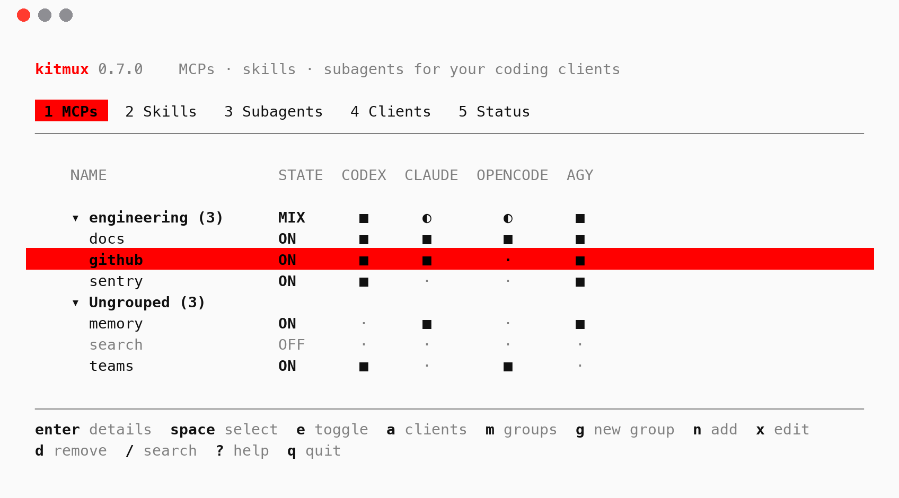
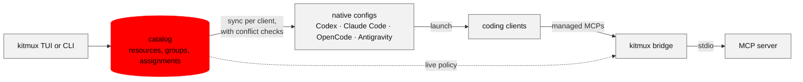

<p align="center">
  <picture>
    <source media="(prefers-color-scheme: dark)" srcset="docs/assets/kitmux-wordmark-dark.svg">
    
  </picture>
</p>

<p align="center">
  <strong>One catalog for the MCP servers, Agent Skills, and subagents your coding agents use.</strong><br>
  Choose which of Codex, Claude Code, OpenCode, and Antigravity sees each one, from a keyboard UI or plain commands.
</p>

<p align="center">
  <a href="https://github.com/cleisson-labs/kitmux/actions/workflows/ci.yml"></a>
  <a href="https://github.com/cleisson-labs/kitmux/releases/latest"></a>
  
  
  <a href="LICENSE"></a>
</p>

<p align="center">
  <picture>
    <source media="(prefers-color-scheme: dark)" srcset="docs/assets/tui-dark.png">
    
  </picture>
</p>

<p align="center">
  <a href="#download-and-install">Install</a> ·
  <a href="#quick-start">Quick start</a> ·
  <a href="#supported-clients">Clients</a> ·
  <a href="#keyboard-controls">Keyboard</a> ·
  <a href="docs/V0.7.md">v0.7 notes</a> ·
  <a href="docs/IMPLEMENTATION.md">Architecture</a> ·
  <a href="CONTRIBUTING.md">Contributing</a>
</p>

## Why Kitmux

- **One source of truth.** Register an MCP server, skill package, or subagent once;
  Kitmux writes each client's native configuration and keeps its own settings intact.
- **Per-client control.** Groups, explicit overrides, and a global switch decide what
  each client sees. A credential never travels to a client you did not assign.
- **Safe by default.** Imports and syncs preview first, owned entries carry restore
  records, and external edits surface as named conflicts instead of being overwritten.
- **Live MCP control.** Optional managed bridges apply ON/OFF to a running client's
  tools and reconnect servers without restarting it (Codex shows tool changes after
  a restart).
- **Keyboard first.** A fast terminal UI with search, bulk selection, and documents,
  plus scriptable commands with `--json` output and read-only `sync --check`.

## Supported clients

| Client | ID | MCP servers | Skills | Subagents |
|---|---|---|---|---|
| Codex | `codex` | `~/.codex/config.toml` | `~/.agents/skills`, legacy `~/.codex/skills` | `~/.codex/agents/*.toml` |
| Claude Code | `claude` | `~/.claude.json` | `~/.claude/skills` | `~/.claude/agents/*.md` |
| OpenCode | `opencode` | `~/.config/opencode/opencode.json(c)` | `~/.config/opencode/skills`, plus permission rules | `~/.config/opencode/agents/*.md` or JSON `agents` |
| Antigravity CLI (`agy`) | `antigravity` | `~/.gemini/config/mcp_config.json` | `~/.gemini/config/skills`, plus `skills.json` exclusions | `~/.gemini/config/agents/<id>.md` |

Kitmux manages user-level configuration. Project and organization settings keep
their native precedence. The Antigravity file is shared by the CLI and the IDE.

## How it works



The catalog is the only place you edit. Every change syncs adopted clients
automatically, one client at a time, so a problem in one client never blocks the
others. Direct MCPs stay owned by each client; managed MCPs run through a small
Kitmux bridge that observes policy and supports reconnect.

## Quick start

Import what your clients already have, group it, and choose who sees it:

```console
$ kitmux import --from codex,claude,opencode,antigravity --preview
preview: codex MCP github
preview: claude MCP github
preview: claude MCP docs
preview: antigravity MCP docs
preview: 0 skill projection actions; run with --apply
$ kitmux import --from codex,claude,opencode,antigravity --apply
$ kitmux mcp group add engineering
$ kitmux mcp group include engineering github docs
$ kitmux mcp group assign engineering --agents codex,claude,antigravity
apply: codex MCP docs -> enabled
apply: antigravity MCP github -> enabled
antigravity: configuration applied; reload required
codex: configuration applied; reload required
$ kitmux mcp list
MCP                    TRANSPORT  MODE       codex claude opencode antigravity
github                 stdio      direct     on    on     off      on
docs                   http       direct     on    on     off      on
$ kitmux sync --check
Selected native projections are current.
```

Run `kitmux` with no arguments for the interactive interface. Reload a client or
start a new session after changes so it reads its updated configuration.

## Download and install

Prebuilt executables for macOS 15+ and Linux with glibc 2.35+ (arm64 and x86_64)
are on [Releases](https://github.com/cleisson-labs/kitmux/releases). They need no
compiler or Homebrew libraries; Linux needs terminfo data (`ncurses-base`), and Git
is used only for repository skills. This block verifies the SHA256 checksum, installs
one pinned release to `~/.local/bin` (or `KITMUX_INSTALL_DIR`), and keeps a regular
previous binary as `kitmux.previous`:

<!-- kitmux-install -->
```sh
(
  set -eu
  kitmux_version=v0.7.0
  case "$(uname -s)" in
    Darwin) kitmux_os=darwin ;;
    Linux) kitmux_os=linux ;;
    *) echo "Unsupported operating system" >&2; exit 1 ;;
  esac
  case "$(uname -m)" in
    arm64|aarch64) kitmux_arch=arm64 ;;
    x86_64|amd64) kitmux_arch=x86_64 ;;
    *) echo "Unsupported architecture" >&2; exit 1 ;;
  esac
  kitmux_name="kitmux-${kitmux_version}-${kitmux_os}-${kitmux_arch}"
  kitmux_url="https://github.com/cleisson-labs/kitmux/releases/download/${kitmux_version}"
  kitmux_tmp=$(mktemp -d)
  kitmux_new= kitmux_backup=
  trap 'rm -rf "$kitmux_tmp"; [ -z "$kitmux_new" ] || rm -f "$kitmux_new"; [ -z "$kitmux_backup" ] || rm -f "$kitmux_backup"' EXIT
  trap 'exit 1' HUP INT TERM
  curl -fL --proto '=https' --tlsv1.2 "$kitmux_url/$kitmux_name.tar.gz" -o "$kitmux_tmp/$kitmux_name.tar.gz"
  curl -fL --proto '=https' --tlsv1.2 "$kitmux_url/SHA256SUMS" -o "$kitmux_tmp/SHA256SUMS"
  awk -v name="$kitmux_name.tar.gz" '$2 == name { print }' "$kitmux_tmp/SHA256SUMS" > "$kitmux_tmp/checksum"
  [ "$(wc -l < "$kitmux_tmp/checksum")" -eq 1 ] || { echo "Missing or ambiguous checksum" >&2; exit 1; }
  (cd "$kitmux_tmp"; if command -v sha256sum >/dev/null 2>&1; then sha256sum -c checksum; else shasum -a 256 -c checksum; fi)
  tar -xzf "$kitmux_tmp/$kitmux_name.tar.gz" -C "$kitmux_tmp"
  [ "$("$kitmux_tmp/$kitmux_name/kitmux" --version)" = "kitmux ${kitmux_version#v}" ]
  kitmux_dir=${KITMUX_INSTALL_DIR:-"$HOME/.local/bin"}
  mkdir -p "$kitmux_dir"
  [ ! -L "$kitmux_dir/kitmux" ] || { echo "Existing kitmux is a symlink; use its original installer" >&2; exit 1; }
  [ ! -e "$kitmux_dir/kitmux" ] || [ -f "$kitmux_dir/kitmux" ]
  if [ -f "$kitmux_dir/kitmux" ]; then
    [ ! -L "$kitmux_dir/kitmux.previous" ] && { [ ! -e "$kitmux_dir/kitmux.previous" ] || [ -f "$kitmux_dir/kitmux.previous" ]; } || {
      echo "Backup path must be absent or a regular file" >&2; exit 1;
    }
  fi
  kitmux_new=$(mktemp "$kitmux_dir/.kitmux.XXXXXXXX")
  install -m 755 "$kitmux_tmp/$kitmux_name/kitmux" "$kitmux_new"
  if [ -f "$kitmux_dir/kitmux" ]; then
    kitmux_backup=$(mktemp "$kitmux_dir/.kitmux.XXXXXXXX")
    cp -p "$kitmux_dir/kitmux" "$kitmux_backup"
    mv -f "$kitmux_backup" "$kitmux_dir/kitmux.previous"
    kitmux_backup=
  fi
  mv -f "$kitmux_new" "$kitmux_dir/kitmux"
  kitmux_new=
  printf 'Installed %s at %s/kitmux\n' "$kitmux_version" "$kitmux_dir"
)
```

Add the install directory to `PATH`, then run `kitmux --version` and `kitmux`.
To upgrade, change `kitmux_version`, rerun the block, and restart coding clients so
managed bridges use the new binary. Moving `kitmux.previous` back rolls back only the
binary; use `restore` for native configuration. v0.4 through v0.7 share catalog
schema 3.

To let your coding agent install Kitmux and import your setup, give it
[this prompt](docs/GUIDE.md#install-with-your-local-agent). To build from source,
see [Build and run from source](docs/GUIDE.md#build-and-run-from-source).

## Keyboard controls

| Key | Action |
|---|---|
| `1`–`5`, Tab | MCPs, Skills, Subagents, Clients, Status |
| Arrows, `j`/`k` | Move selection |
| Enter | Expand/collapse a group; open a resource document |
| Left/Right | Collapse/expand a group |
| `v` | Show group details or open a resource document |
| Space | Select multiple rows |
| `/`, Esc | Filter; clear filter or cancel |
| `n`, `x`, `d` | Add, edit, remove |
| `g` | Create a group inside the current resource tab |
| `p` on Subagents | Duplicate a definition with a new ID |
| `e`, `a`, `m` | Toggle, assign clients, edit group memberships |
| `r` | Reconnect selected MCP |
| `s`, `i` | Preview/apply native sync or import |
| `u`, `b` | Preview/apply skill update or roll back |
| `c`, `?`, `q` | Check configuration, help, quit |
| `f` on Status, Clients | Refresh the status snapshot or client state |

Space marks rows for bulk actions, `a` changes only the clients you touch, and the
Clients tab shows adoption and pending native sync. See
[Terminal interface](docs/GUIDE.md#terminal-interface) for documents, colors, and
groups.

## Availability rules

A globally disabled resource is off everywhere. An explicit per-client `off` wins
over groups. Otherwise a direct `on` or any enabled group assigned to the client
turns it on, and no assignment means off. Details are in
[Availability rules](docs/GUIDE.md#availability-rules).

## Learn more

- [Guide](docs/GUIDE.md): first use, configuration as code, MCP servers and the
  managed bridge, skills, subagents, configuration safety, and development.
- [v0.7 release notes](docs/V0.7.md) and earlier [v0.6](docs/V0.6.md),
  [v0.5](docs/V0.5.md), and [v0.4](docs/V0.4.md) notes.
- [Architecture and verification](docs/IMPLEMENTATION.md),
  [native client qualification](docs/NATIVE_CLIENT_QUALIFICATION.md), and
  [third-party notices](THIRD_PARTY.md).

## Development

```sh
make test        # unit and terminal tests in temporary homes
make sanitize    # the same suite under ASan/UBSan
make analyze     # cppcheck static analysis
```

CI requires one gate, `ci-ok`: workflow linting, static analysis, and both suites on
macOS 15 and Ubuntu 22.04 (arm64 and x86_64). Releases carry verifiable build
provenance; see [Development and verification](docs/GUIDE.md#development-and-verification).

## Contributing and license

See [CONTRIBUTING.md](CONTRIBUTING.md) and [SECURITY.md](SECURITY.md). Kitmux is
available under the [MIT license](LICENSE); vendored code keeps its notices in
[THIRD_PARTY.md](THIRD_PARTY.md).
